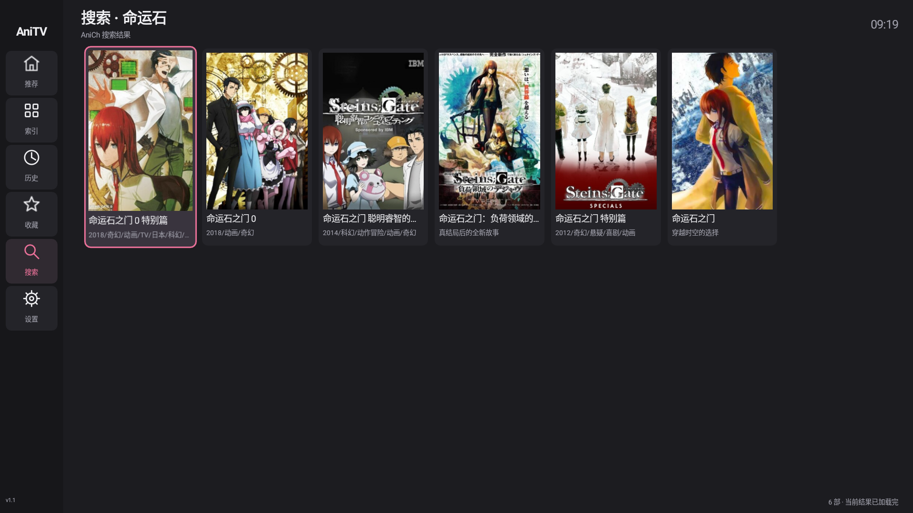
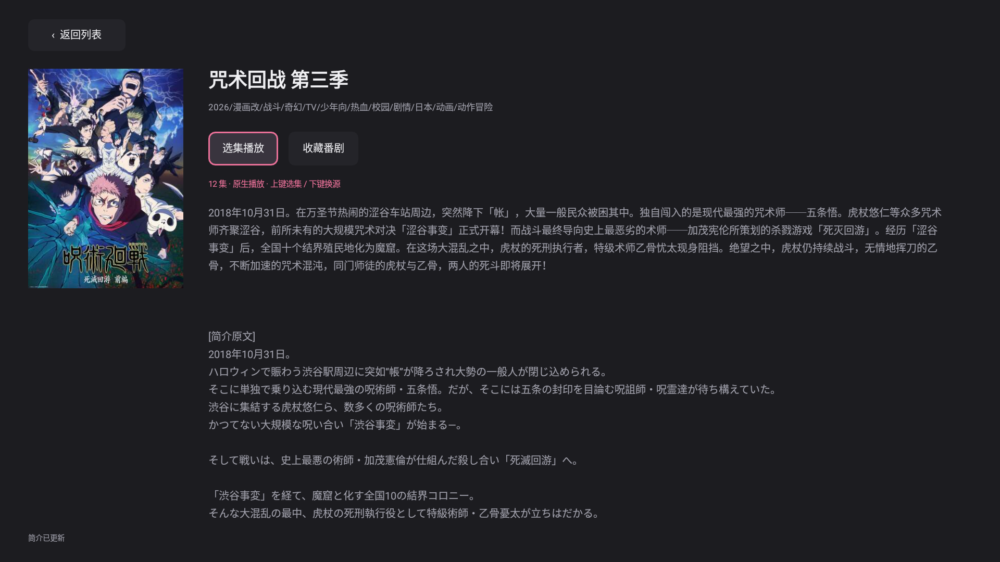

<div align="center">
  

  <h1>AniTV</h1>
  <p>为 Android TV 打造的原生番剧浏览与播放客户端</p>
  <p>
    <a href="https://github.com/Emokui/AniTV/releases/tag/v1.1">下载 1.1</a> ·
    <a href="native-preview/">浏览源码</a> ·
    <a href="native-preview/README.md">构建说明</a>
  </p>
</div>

## 项目简介

AniTV 是面向电视大屏的原生 Android 番剧客户端。界面围绕遥控器操作设计，提供推荐与索引浏览、搜索、番剧详情、剧集选择和多线路播放。

当前源码对应正式版 **1.1（versionCode 30132）**，完整 Gradle 工程位于 [`native-preview/`](native-preview/)。

## 功能一览

| 浏览与管理 | 播放与操作 |
| --- | --- |
| 推荐、分类索引、筛选与关键词搜索 | 多线路选择与线路记忆 |
| 番剧详情、相关作品与封面选集 | 播放进度恢复与历史记录 |
| 收藏、缓存管理与侧栏导航 | MP4 / HLS、倍速与画面比例设置 |
| 面向电视的方向键与确认键交互 | 适配遥控器的弹窗和焦点移动 |

## 界面预览

<table>
  <tr>
    <td align="center" width="50%"><strong>搜索结果</strong><br /></td>
    <td align="center" width="50%"><strong>番剧详情</strong><br /></td>
  </tr>
  <tr>
    <td align="center" colspan="2"><strong>封面选集</strong><br /></td>
  </tr>
</table>

## 下载与安装

前往 [AniTV 1.1 发布页](https://github.com/Emokui/AniTV/releases/tag/v1.1) 获取安装包或源码：

- [下载 Android APK](https://github.com/Emokui/AniTV/releases/download/v1.1/AniTV-1.1-30132.apk)
- [下载完整源码 ZIP](https://github.com/Emokui/AniTV/releases/download/v1.1/AniTV-1.1-30132-source.zip)

版本：**1.1**（versionCode `30132`） · 最低系统：**Android 8.0 / API 26**

## 从源码构建

仓库中的 [native-preview](native-preview/) 是完整的 Gradle 工程。构建环境需要 JDK 17 或更高版本、Android SDK Platform 35 和 Build Tools 35。

```sh
git clone https://github.com/Emokui/AniTV.git
cd AniTV/native-preview
bash build-native.sh assembleRelease
```

也可以在 Android Studio 中直接打开 `native-preview/`。成功构建后，APK 位于 `app/build/outputs/apk/release/`。更多说明见 [构建文档](native-preview/README.md)。

> 在线目录和播放线路依赖 AniCh 服务及相应视频源的可用性。项目源码不包含 Release 签名私钥。

## 项目结构

- [`native-preview/`](native-preview/) — Android TV 应用工程
- [`CHANGELOG.md`](CHANGELOG.md) — 版本变更记录
- [`LICENSE`](LICENSE) — MIT 许可证

## 许可证

本项目采用 [MIT License](LICENSE)。
