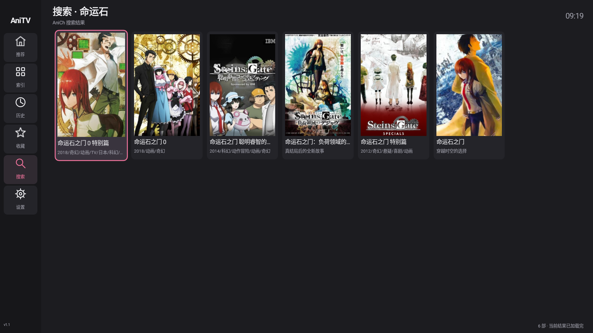
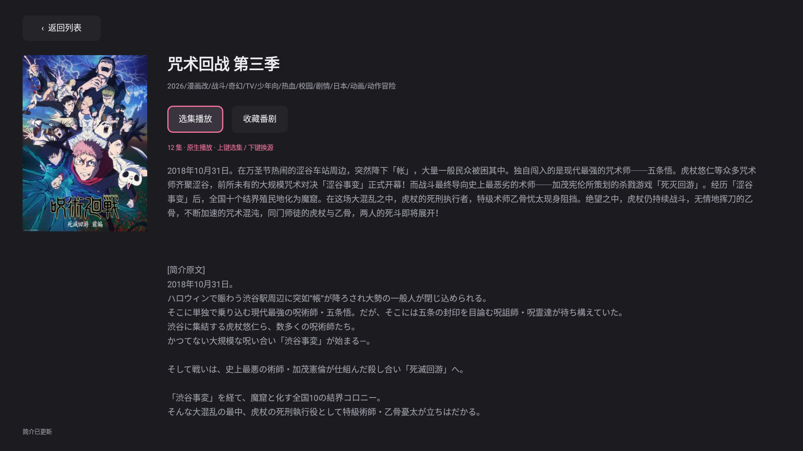
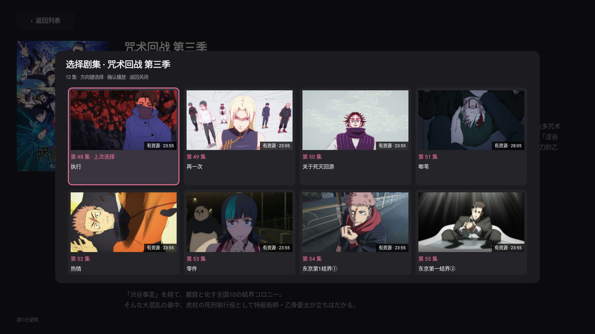

<div align="center">
  
  <h1>AniTV</h1>
  <p>面向 Android TV 的原生番剧浏览与播放客户端</p>
  <p><a href="https://github.com/Emokui/AniTV/releases">下载发布版</a> · <a href="android/">浏览源码</a> · <a href="android/README.md">构建说明</a></p>
</div>

## 版本与安装

当前源码对应 **1.1（构建号 30136）**，支持 **Android 8.0 / API 26 及以上**。进度迁移、线路切换和收藏多选详见 [30136 版本说明](docs/releases/RELEASE-1.1-30136.md)。

从 [GitHub Releases](https://github.com/Emokui/AniTV/releases) 下载对应构建的 APK。以相同签名覆盖安装，可保留账号、收藏、历史和设置。

## 功能

| 浏览与管理 | 播放与操作 |
| --- | --- |
| 推荐、分类索引、按类型、语言和年份筛选 | MP4 / HLS、倍速、画面比例 |
| 关键词搜索、相关作品、封面选集 | 续播、自动下一集、按番剧记忆线路 |
| 历史与收藏批量选择、缓存管理 | 线路超时自动换线、遥控器焦点导航 |

在侧栏长按推荐或索引的确认键 **2 秒**可刷新目录和剧集缓存。索引页按菜单键回到筛选。历史或收藏页按菜单键进入多选，确认键勾选，末行按下进入操作栏。

播放中按左右键快进或快退，长按加速。上键打开选集并定位当前集，下键选线路，菜单键打开播放设置。返回键可关闭弹窗，在播放主界面再按一次返回退出。

安全模式默认开启，列表筛选依赖接口返回和可识别的分级标记。目录和剧集元数据默认缓存 12 小时，可在设置中清理。

## 界面预览

<table>
  <tr>
    <td align="center" width="50%"><strong>搜索结果</strong><br /></td>
    <td align="center" width="50%"><strong>番剧详情</strong><br /></td>
  </tr>
  <tr>
    <td align="center" colspan="2"><strong>封面选集</strong><br /></td>
  </tr>
</table>

## 源码与构建

JDK 17 或以上、Android SDK Platform 35 和 Build Tools 35。在仓库根目录执行：

```sh
bash android/build-native.sh assembleRelease
```

输出位于 `android/app/build/outputs/apk/release/app-release.apk`。测试、签名和项目路径见 [构建说明](android/README.md)。

- [android/](android/) 包含 Gradle 工程、应用源码和测试。
- [docs/](docs/) 收录截图与版本说明。
- [CHANGELOG.md](CHANGELOG.md) 记录各版本变更。

本项目采用 [MIT 许可](LICENSE)。
